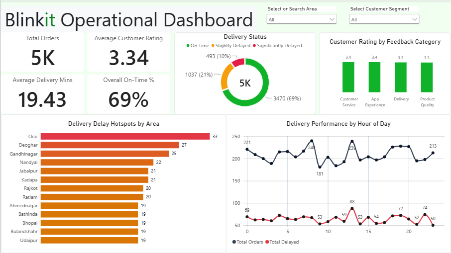

# Blinkit Operational & Delivery Performance Analytics

An end-to-end data analytics project examining quick-commerce fulfilment operations, SLA breach dynamics, geographic bottleneck distribution, and customer satisfaction across 5,000 orders. The analytical pipeline encompasses ETL and feature engineering in **Python (Pandas)**, relational query modeling in **SQL (DuckDB)**, and interactive visual reporting in **Power BI**.

---

## 📊 Dashboard Preview



---

## Project Overview & Key Findings

- **Order Volume & Fleet Throughput:** Evaluated 5,000 transactional orders across 2,500 unique customers. The fleet maintains a baseline average delivery turnaround time of **19.43 minutes** against an average promised SLA of ~15–18 minutes.
- **SLA Compliance Profile:** Overall baseline on-time fulfillment stands at **69.4%** (3,470 orders), with **20.7% slightly delayed** (1,037 orders) and **9.9% significantly delayed** (493 orders).
- **Geographic Bottlenecks:** Delays cluster heavily in specific regional hubs. The top three operational choke points by volume of delayed orders are **Orai (33 delayed orders)**, **Deoghar (27)**, and **Gandhinagar (25)**.
- **Hourly Dispatch Surges vs. Delays:** Peak incoming order demand spikes at 8:00 AM (240 orders) and 1:00 PM (239 orders). However, operational delay volumes peak severely during the mid-day 1:00 PM lunch window (88 delayed deliveries), identifying a recurring shift-change and fleet capacity bottleneck.
- **Customer Satisfaction (CSAT):** Baseline customer satisfaction averages **3.34 / 5.0**. The lowest categorical score stems from **Product Quality (3.3 / 5.0)**, while Customer Service, App Experience, and Delivery categories average ~3.3–3.4.

---

## Tech Stack & Data Flow

- **ETL / Cleaning:** Python (Jupyter Notebook, Pandas)
- **Database / Analytical SQL:** DuckDB (ANSI SQL via VS Code DuckDB Extension)
- **Data Modeling & Visualization:** Power BI Desktop (DAX, Slicers, Multi-axis time-series)

```
[Raw Tables]
├── blinkit_orders.csv (5,000 rows)
├── blinkit_delivery_performance.csv (5,000 rows)
├── blinkit_customer_feedback.csv (5,000 rows)
└── blinkit_customers.csv (2,500 rows)
                │
                ▼ (Python / Pandas)
  - ISO Datetime Parsing (errors='coerce')
  - Turnaround Duration: (actual - order_date) / 60
  - Promised Duration: (promised - order_date) / 60
  - SLA Breach Indicator: (actual > promised)
  - Missing Delay Reason Imputation ('No Delay')
  - Relational Left Merges on order_id & customer_id
                │
                ▼
      [blinkit_cleaned.csv]
         ├──► SQL Analysis (DuckDB): Delay rankings, category ratings, tier compliance
         └──► Power BI Dashboard: Single-page executive operations report
```

---

## Data Pipeline & Feature Engineering (Python)

The raw schema presented ambiguous duration metrics (such as negative elapsed minutes in delivery logs due to variance calculation). The Jupyter Notebook ETL (`dataCleaning.ipynb`) addresses this by engineering exact elapsed minute durations and joining dimension attributes.

### Core Processing Steps:

1. **Datetime Type Casting:**
   ```python
   orders['order_date'] = pd.to_datetime(orders['order_date'], errors='coerce')
   orders['promised_delivery_time'] = pd.to_datetime(orders['promised_delivery_time'], errors='coerce')
   orders['actual_delivery_time'] = pd.to_datetime(orders['actual_delivery_time'], errors='coerce')
   ```
2. **Turnaround & SLA Feature Engineering:**

   ```python
   # Actual elapsed turnaround time in minutes
   orders['actual_delivery_in_mins'] = (
       orders['actual_delivery_time'] - orders['order_date']
   ).dt.total_seconds() / 60.0

   # Promised turnaround duration in minutes
   orders['promised_delivery_in_mins'] = (
       orders['promised_delivery_time'] - orders['order_date']
   ).dt.total_seconds() / 60.0

   # Binary flag: 1 if delivery exceeded promised SLA timestamp, else 0
   orders['is_delayed'] = (orders['actual_delivery_time'] > orders['promised_delivery_time']).astype(int)
   ```

3. **Relational Merges & Missing Value Handling:**

   ```python
   # Merge delivery performance (1-to-1 on order_id)
   df_analytics = orders.merge(
       delivery[['order_id', 'distance_km', 'reasons_if_delayed']],
       on='order_id',
       how='left'
   )

   # Merge customer feedback (1-to-1 on order_id)
   df_analytics = df_analytics.merge(
       feedback[['order_id', 'rating', 'feedback_category', 'sentiment']],
       on='order_id',
       how='left'
   )

   # Merge customer demographic & tier data (many-to-1 on customer_id)
   df_analytics = df_analytics.merge(
       customers[['customer_id', 'area', 'customer_segment']],
       on='customer_id',
       how='left'
   )

   # Impute null delay reasons for on-time fulfillment
   df_analytics['reasons_if_delayed'] = df_analytics['reasons_if_delayed'].fillna('On Time / No Delay')
   df_analytics['reasons_if_delayed'] = df_analytics['reasons_if_delayed'].replace('On Time / No Delay', 'No Delay')

   # Export consolidated analytical staging file
   df_analytics.to_csv("blinkit_cleaned.csv", index=False)
   ```

---

## SQL Operational Analysis (DuckDB)

Analytical queries executed directly against `blinkit_cleaned.csv` using DuckDB:

### Query 1: Top 5 Highest Delivery Delay Areas

Identifies regional dark-store catchment zones experiencing the highest frequency of delivery SLA breaches and quantifies their average delay duration:

```sql
SELECT
    area,
    COUNT(*) AS total_delayed,
    ROUND(AVG(actual_delivery_in_mins - promised_delivery_in_mins), 2) AS avg_delay_mins
FROM 'blinkit_cleaned.csv'
WHERE is_delayed = 1
GROUP BY area
ORDER BY total_delayed DESC
LIMIT 5;
```

### Query 2: Customer Rating by Feedback Category

Aggregates customer review distributions across operational categories to pinpoint service dissatisfaction:

```sql
SELECT
    feedback_category,
    COUNT(feedback_category) AS total_feedbacks,
    ROUND(AVG(rating), 2) AS average_rating
FROM "blinkit_cleaned.csv"
GROUP BY feedback_category
ORDER BY average_rating ASC;
```

### Query 3: On-Time Fulfillment by Customer Tier

Analyzes whether operational SLA compliance differs between customer loyalty segments:

```sql
SELECT
    customer_segment,
    COUNT(*) AS total_deliveries,
    SUM(CASE WHEN delivery_status = 'On Time' THEN 1 ELSE 0 END) AS total_on_time,
    SUM(CASE WHEN delivery_status <> 'On Time' THEN 1 ELSE 0 END) AS total_delayed,
    ROUND(AVG(actual_delivery_in_mins - promised_delivery_in_mins), 2) AS avg_delay_mins,
    ROUND(100.0 * SUM(CASE WHEN delivery_status = 'On Time' THEN 1 ELSE 0 END) / COUNT(*), 2) AS on_time_percentage
FROM "blinkit_cleaned.csv"
GROUP BY customer_segment
ORDER BY on_time_percentage ASC;
```

### Query 4: Customer Segment Revenue & Order Share (Window Function)

Uses an empty `OVER()` window clause to evaluate total order contribution percentage and AOV across segments:

```sql
SELECT
    customer_segment,
    COUNT(DISTINCT customer_id) AS unique_customers,
    COUNT(order_id) AS Total_orders,
    SUM(order_total) AS Total_of_orders,
    ROUND(100.0 * COUNT(order_id) / SUM(COUNT(order_id)) OVER(), 2) AS percentage_of_total_orders,
    ROUND(AVG(order_total), 2) AS avg_order_total
FROM "blinkit_cleaned.csv"
GROUP BY customer_segment
ORDER BY Total_of_orders DESC;
```

---

## Power BI Executive Dashboard

The Power BI report (`Blinkit Operational Dashboard`) is structured on a single 16:9 canvas designed for fleet leads and operations managers.

### 1. KPI Metric Measures (DAX)

- **Order Count:**
  ```dax
  Total Orders = COUNT(blinkit_cleaned[order_id])
  ```
- **CSAT Benchmark:**
  ```dax
  Average Customer Rating = AVERAGE(blinkit_cleaned[rating])
  ```
- **Turnaround Minutes:**
  ```dax
  Average Delivery Time = AVERAGE(blinkit_cleaned[actual_delivery_in_mins])
  ```
- **Context-Preserving On-Time %:**
  Uses `KEEPFILTERS` to respect global filter selections without throwing scale anomalies when delay categories are selected:

  ```dax
  On Time Orders =
  CALCULATE(
      [Total Orders],
      KEEPFILTERS(blinkit_cleaned[delivery_status] = "On Time")
  )

  Overall On-Time % =
  DIVIDE([On Time Orders], [Total Orders], 0)
  ```

### 2. Report Visualizations

1. **Executive Scorecards:** Four top-left KPI cards reporting Total Orders (5K), Average Customer Rating (3.34), Average Delivery Minutes (19.43 mins), and Overall On-Time % (69%).
2. **Delivery Status Donut:** Proportional breakdown of order fulfilment (3,470 On Time, 1,037 Slightly Delayed, 493 Significantly Delayed).
3. **Customer Rating by Category:** Column chart displaying CSAT distribution across Customer Service (3.4), App Experience (3.4), Delivery (3.3), and Product Quality (3.3).
4. **Delivery Delay Hotspots by Area:** Horizontal bar chart filtering the top bottleneck delivery zones (led by Orai at 33, Deoghar at 27, Gandhinagar at 25).
5. **Delivery Performance by Hour of Day:** Synchronised dual-line time series tracking `Total Orders` (grey line) alongside `Total Delayed` (highlight line) across hours 0 to 23, revealing lunch and dinner SLA stress periods.
6. **Global Filters:** Dropdown slicers for `Select or Search Area` and `Select Customer Segment`.

---

## 💡 Operational Recommendations

1. **Afternoon Shift Fleet Balancing:** Re-allocate delivery partner rosters to cover the 12:30 PM – 2:30 PM lunch surge. Delays currently jump by 66% during this window despite order volumes matching the morning rush.

2. **Targeted Hub Interventions:** Conduct route and dark-store dispatch audits in Orai and Deoghar, where high transit delays suggest dense traffic corridors or inefficient store pick-and-pack times.

3. **Post-Delivery Feedback Intervention:** Since satisfaction drops to 3.3 on Delivery and Product Quality orders, implement automated proactive delay alerts and instant credits to resolve delivery-related issues before customers leave lower ratings.

---

## Setup & Reproduction

1. **Clone the Repository:**
   ```bash
   git clone https://github.com/Harsh-Devv/blinkit-operations-analysis.git
   cd blinkit-operations-analysis
   ```
2. **Data Cleaning & Preprocessing:**
   ```bash
   pip install pandas duckdb
   jupyter notebook notebooks/dataCleaning.ipynb
   ```
3. **Execute SQL Queries:**
   - Open `queries.sql` in VS Code with the DuckDB extension installed, or run directly via the DuckDB CLI against `blinkit_cleaned.csv`.
4. **View Power BI Dashboard:**
   - Open `Blinkit Dashboard.pbix` in Power BI Desktop.
